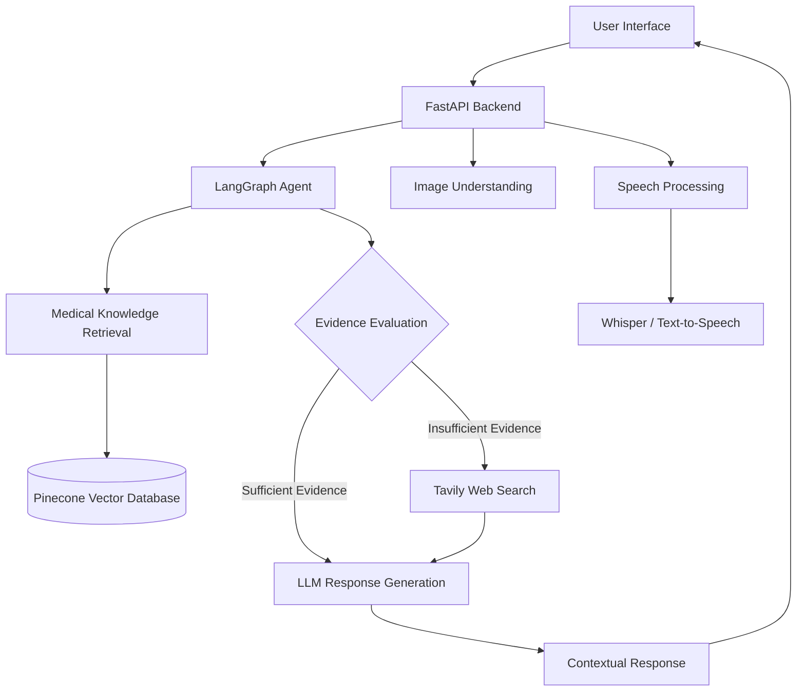

# Medical-Agentic-Chatbot

### Agentic AI Healthcare Assistant | LangGraph · RAG · Pinecone · FastAPI · Multimodal AI

An AI-powered healthcare information platform built using agentic workflows and Retrieval-Augmented Generation (RAG). The system combines medical knowledge retrieval, intelligent query routing, external information discovery, and multimodal AI capabilities to provide context-aware healthcare information.

Built with a modular backend architecture, the platform integrates LangGraph for agent orchestration, Pinecone for semantic vector retrieval, FastAPI for backend services, and multimodal AI for image and voice interactions.


---

## Key Features

- **Agentic AI Workflows:** Multi-stage agent orchestration using LangGraph.
- **Retrieval-Augmented Generation (RAG):** Context-aware responses grounded in retrieved medical knowledge.
- **Vector Search:** Semantic document retrieval using Pinecone.
- **Intelligent Query Routing:** Conditional workflow execution based on retrieved evidence.
- **External Information Retrieval:** Tavily integration as a fallback when internal knowledge is insufficient.
- **Multimodal Image Understanding:** Image observation using vision-capable AI models.
- **Speech-to-Text:** Voice input processing using Whisper.
- **Text-to-Speech:** AI-generated spoken responses.
- **REST API:** Backend services implemented using FastAPI.
- **Interactive Web Interface:** Browser-based chat interface with text, image, and voice interaction.

## System Architecture



## Technology Stack

| Component | Technology |
|---|---|
| Programming Language | Python 3.11 / 3.12 |
| Agent Orchestration | LangGraph |
| LLM Integration | OpenAI-compatible APIs / Groq |
| RAG Architecture | Retrieval-Augmented Generation |
| Vector Database | Pinecone |
| Embedding Model | OpenAI text-embedding-3-small |
| External Search | Tavily |
| Backend Framework | FastAPI |
| Speech Recognition | Whisper |
| Speech Generation | Text-to-Speech |
| Frontend | HTML, CSS, JavaScript |
| API Documentation | Swagger / OpenAPI |

## Project Structure

```text
Medical-Agentic-Chatbot/
│
├── app/
│   ├── config.py
│   ├── knowledge.py
│   ├── agent.py
│   └── main.py
│
├── data/
│   └── medical_book.pdf
│
├── templates/
│   └── index.html
│
├── static/
│   ├── style.css
│   └── app.js
│
├── ingest.py
├── requirements.txt
├── .env.example
├── .gitignore
└── README.md
```

## Agent Workflow

The LangGraph-based agent follows a structured execution pipeline:

1. **Query Processing:** Receives and processes the user's healthcare-related query.
2. **Knowledge Retrieval:** Searches the internal medical knowledge base using semantic similarity.
3. **Evidence Evaluation:** Evaluates retrieved information for relevance and sufficiency.
4. **Conditional Routing:** Determines whether internal knowledge is sufficient or external retrieval is required.
5. **External Search:** Uses Tavily to retrieve additional information when necessary.
6. **Response Generation:** Generates a context-aware response using the available evidence.
7. **Response Delivery:** Returns the generated response through the FastAPI backend.

## Core Engineering Components

### 1. Agentic Orchestration
LangGraph manages the agent's execution flow, conditional routing, and interaction between retrieval and generation components.

### 2. Knowledge Retrieval Pipeline
The document ingestion pipeline extracts readable PDF content, splits it into manageable chunks, generates vector embeddings, and stores them in Pinecone.

### 3. Conditional Retrieval
The agent evaluates retrieved context and can invoke Tavily when the internal knowledge base does not provide sufficient information.

### 4. Multimodal Processing
Dedicated backend endpoints support image observations, speech recognition, and speech generation.

### 5. Backend Architecture
FastAPI exposes application services through REST endpoints and provides interactive API documentation through Swagger UI.

## Installation and Setup

### Prerequisites

- Python 3.11 or 3.12
- Conda or Python virtual environment
- OpenAI API key
- Pinecone API key
- Tavily API key (optional)
- Internet connection

### 1. Clone the Repository

```bash
git clone https://github.com/Jamshaid9291/Medical-Agentic-Chatbot.git

cd Medical-Agentic-Chatbot
```

### 2. Create the Environment

```bash
conda create -n medical-ai python=3.11 -y

conda activate medical-ai
```

### 3. Install Dependencies

```bash
pip install -r requirements.txt
```

### 4. Configure Environment Variables

Create a `.env` file in the project root and configure the required API credentials.

```env
OPENAI_API_KEY=your_openai_api_key
PINECONE_API_KEY=your_pinecone_api_key
TAVILY_API_KEY=your_tavily_api_key
```

Add any additional configuration variables required by the application.

### 5. Initialize the Medical Knowledge Base

```bash
python ingest.py --pdf data/medical_book.pdf
```

This process extracts document content, generates embeddings, and indexes the resulting vectors in Pinecone.

**Note:** The default embedding model, `text-embedding-3-small`, produces 1536-dimensional vectors. The Pinecone index configuration must match the embedding dimensions.

### 6. Start the Application

```bash
uvicorn app.main:app --reload --host 127.0.0.1 --port 8000
```

### 7. Access the Application

| Service | URL |
|---|---|
| Web Application | http://127.0.0.1:8000 |
| API Documentation | http://127.0.0.1:8000/docs |
| Health Check | http://127.0.0.1:8000/api/health |

## Configuration and Troubleshooting

| Issue | Recommended Action |
|---|---|
| API Authentication Error (401) | Verify API credentials and configure the API access token if enabled. |
| Backend Error (502) | Inspect backend logs and verify external service credentials and connectivity. |
| Empty Knowledge Retrieval | Run the document ingestion pipeline and verify the Pinecone index. |
| Embedding Dimension Mismatch | Ensure Pinecone dimensions match the configured embedding model. |
| External Search Failure | Verify Tavily credentials and service availability. |
| Camera or Microphone Issues | Check browser permissions and use localhost or HTTPS. |

## Security and Reliability

The current implementation is an engineering reference and requires additional hardening before real-world healthcare deployment.

Potential production engineering enhancements include:

- Secure authentication and authorization.
- Encrypted data storage and transmission.
- API rate limiting and request validation.
- Structured logging and error monitoring.
- Automated unit and integration testing.
- RAG evaluation and response faithfulness assessment.
- Conversation persistence and retention controls.
- Clinical safety evaluation and expert-reviewed emergency escalation.
- Privacy, licensing, and regulatory compliance reviews.

## Knowledge Base

The initial knowledge source is:

**Gale Encyclopedia of Medicine (2002), Volume 1 (A–B).**

The document serves as the initial reference corpus for demonstrating PDF ingestion, vector indexing, and semantic retrieval.

The reference is historical and may contain outdated medical information. It should not be treated as a current clinical authority.

## Future Engineering Roadmap

- [ ] Persistent conversation memory.
- [ ] Improved document citation and source attribution.
- [ ] RAG evaluation and retrieval-quality metrics.
- [ ] Automated agent workflow testing.
- [ ] PostgreSQL-based conversation persistence.
- [ ] Docker-based containerization.
- [ ] Redis-based caching and background processing.
- [ ] Observability and LLM execution tracing.
- [ ] Improved authentication and access control.
- [ ] Evaluation against current, authoritative medical references.

## Project Objectives

This project demonstrates practical implementation of:

- Agentic AI systems and workflow orchestration.
- Retrieval-Augmented Generation architectures.
- Semantic search and vector database integration.
- Conditional tool execution and intelligent routing.
- Multimodal AI application development.
- REST API development and backend integration.
- Modular and extensible AI application architecture.

---

**Author:** Jamshaid Ali

**GitHub:** [@Jamshaid9291](https://github.com/Jamshaid9291)
